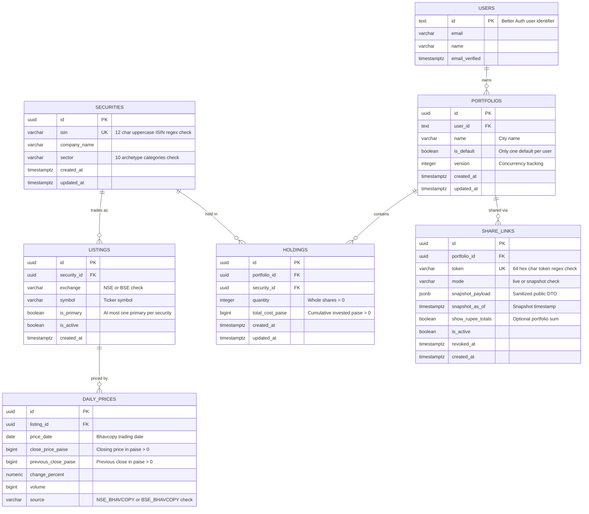
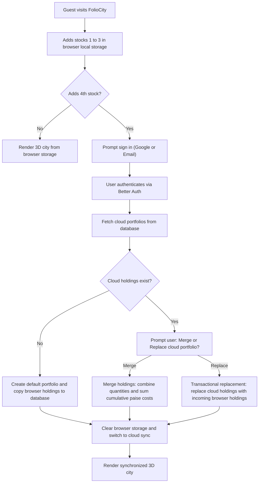
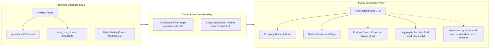
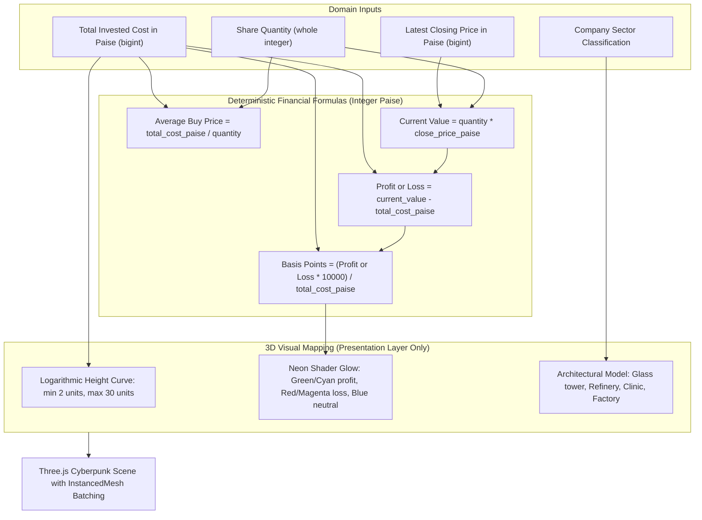

# FolioCity Data Model and Architectural Diagrams

## 1. Entity Relationship Diagram

The diagram below illustrates the relational schema modeled in Drizzle ORM. Canonical securities are separated from exchange listings to support dual listed stocks across NSE and BSE, while monetary columns persist as native integer paise (`bigint`) to eliminate rounding drift.

## 2. Guest to Cloud Account Synchronization Flow

First time visitors store up to three holdings in browser local storage using canonical ISIN identifiers. When adding a fourth stock, signing in triggers the synchronization process.

## 3. Public Sharing Privacy Projection Boundary

To prevent viewers from discovering private holding sizes, individual holding rupee values and share counts are stripped at the server projection boundary. Total rupee amounts are optionally shown only at the aggregate portfolio level, and automatically suppressed if the portfolio contains only one stock.

## 4. Mathematical Valuation to 3D Scene Pipeline

The diagram below traces how exact financial numbers in integer paise (`bigint`) map into procedural 3D building geometries and neon visual shaders without floating point inaccuracies.

